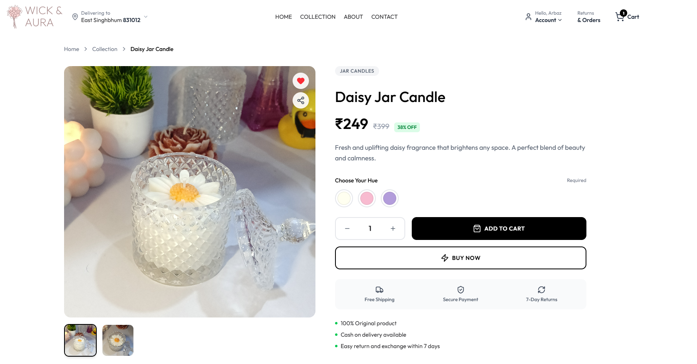
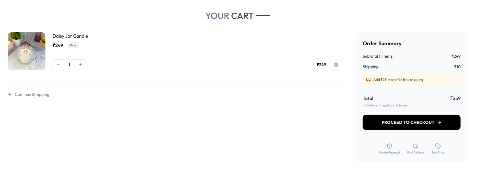

    # Wick & Aura — Candle E-Commerce Platform

    Full-stack MERN e-commerce app for a candle business: a customer storefront, a REST API, and a separate admin panel. Includes OTP-based auth with optional 2FA, Razorpay payments, and server-synced cart/wishlist.

    
    
    

    ---

    ## Architecture

    ```
    wick-and-aura-website/
    ├── frontend/   # Customer storefront  (React + Vite)
    ├── admin/      # Admin panel          (React + Vite)
    └── backend/    # REST API             (Express + MongoDB)
    ```

    Both React apps talk to the same Express API. Admin routes are protected with a separate token-based admin login.

    ## Tech Stack

    | Layer            | Stack                                                                            |
    | ---------------- | -------------------------------------------------------------------------------- |
    | Frontend / Admin | React 19, Vite, Tailwind CSS v4, React Router, Context API, Axios, Framer Motion |
    | Backend          | Node.js, Express 5, MongoDB + Mongoose, JWT, bcrypt, Multer                      |
    | Integrations     | Razorpay (payments), Nodemailer (OTP emails), Cloudinary (image hosting)         |

    ---

    ## Key Features & Engineering Highlights

    **Authentication & security**

    - Email/password signup with OTP email verification
    - Optional 2FA: login requires an OTP when enabled
    - JWT-protected routes; separate admin authentication

    **Cart & checkout**

    - Guest cart that merges into the user's server-side cart on login
    - Color variants and quantity management
    - Cash on Delivery and Razorpay, with server-side payment verification

    **Catalog & user account**

    - Search, filter and sort by category, type and price
    - Order history and status tracking
    - Profile, address and security (2FA) management

    **Frontend**

    - Mobile-first responsive layouts
    - Global state with React Context (products, cart, orders, wishlist, user)
    - Page transitions with Framer Motion

    ---

    ## Author

    **Arbaz Tahir** — Frontend Developer · [GitHub](https://github.com/Arbaz9234) · [LinkedIn](https://www.linkedin.com/in/arbaz9234/) ·
    <a href="#" onclick="navigator.clipboard.writeText('arbaz9234@gmail.com'); return false;">
    Email
    </a>

    _Proprietary project, not licensed for public use._
